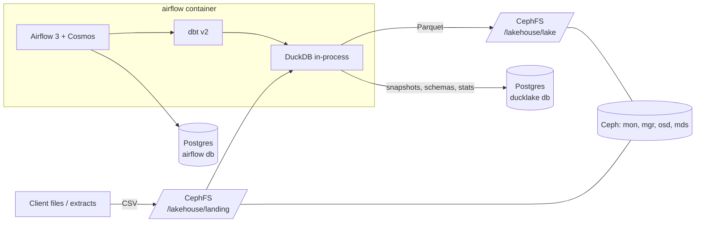

# Teratai Lakehouse: minimal DuckDB + DuckLake stack

This branch (`ducklake-minimal`) is a slimmed-down take on Teratai. Spark, MinIO, the Iceberg REST catalog and OpenMetadata are gone. What remains:

| Piece | Role |
|---|---|
| **DuckDB** | Query engine. Runs in-process inside each dbt invocation, so there's no cluster. |
| **DuckLake** | Table format and catalog. Snapshots, schema evolution and time travel; catalog metadata in Postgres, data as Parquet. |
| **CephFS** | Storage. A single-node Ceph cluster serves a POSIX filesystem that holds the landing CSVs and every lake Parquet file. |
| **dbt v2** (`dbt-oss`) | Transformations. Uses the Rust engine with built-in DuckDB and writes to DuckLake through `catalogs.yml`. |
| **Airflow 3 + astronomer-cosmos** | Orchestration. Cosmos turns each dbt model and test into an Airflow task. |

There are three containers in total: `ceph`, `postgres` and `airflow`.



## Quick start

```bash
git checkout ducklake-minimal
docker compose up -d --build        # first boot takes a minute while Ceph bootstraps
docker compose ps                   # wait until all three are healthy
```

1. Open Airflow at http://localhost:8080. Local dev mode has no login.
2. Trigger **`teratai_sample_data`**. It writes a synthetic banking dataset to `/lakehouse/landing/<table>/*.csv`.
3. Trigger **`teratai_lakehouse`**. It checks the landing files, attaches the lake, then runs all dbt models and tests as Cosmos tasks.
4. Query the result:

```bash
docker compose exec airflow lake                       # DuckDB shell with the lake attached
docker compose exec airflow lake -c "from marts.dim_customers limit 5"
docker compose exec airflow lake -c "from ducklake_snapshots('lake')"   # DuckLake snapshot history
```

To load your own data, put CSVs in `/lakehouse/landing/<table>/` (any number of files per table, all with a header row). The raw layer picks up every file.

## Layout

```
docker-compose.yml
ceph/                    single-node Ceph image + bootstrap script (mon/mgr/osd/mds + CephFS)
postgres/init/           creates the `ducklake` catalog database next to `airflow`
airflow/
  Dockerfile             Airflow 3.3 + cosmos, ceph-fuse, dbt-oss v2 (own venv), DuckDB ADBC driver, DuckDB CLI
  bin/teratai-entrypoint mounts CephFS at /lakehouse, then drops to the airflow user
  bin/lake               DuckDB CLI pre-attached to the lake
  dags/                  teratai_lakehouse (Cosmos), teratai_sample_data
dbt/teratai/
  catalogs.yml           DuckLake catalog `lake` (metadata: Postgres, data: /lakehouse/lake/)
  profiles.yml           DuckDB in-memory + ducklake/postgres extensions
  models/raw             read_csv() over the CephFS landing zone (all text)
  models/staging         typing, cleaning
  models/intermediate    customer 360, loan portfolio, enriched transactions (incremental)
  models/marts           dim_customers, fct_transactions, fct_account_summary
  models/analytics       CLV, segmentation, loan portfolio, transaction patterns
```

Every model writes to the DuckLake catalog `lake`, which is set by `+catalog_name: lake` in `dbt_project.yml`. Schemas are `raw`, `staging`, `intermediate`, `marts` and `analytics`, so tables appear as `lake.marts.dim_customers` and so on.

## How the pieces connect

- **Ceph to Airflow.** The `ceph` container bootstraps a one-OSD cluster on first start. The OSD is a sparse BlueStore file whose size is set by `CEPH_OSD_SIZE_GB`, default 20. The script creates a CephFS filesystem named `lakehouse` and exports a client keyring and `ceph.conf` into the shared `ceph-client` volume. The Airflow entrypoint waits for that, mounts CephFS with `ceph-fuse` at `/lakehouse`, and then starts Airflow as the `airflow` user.
- **DuckLake catalog.** `catalogs.yml` uses `metadata_path: postgres:dbname=ducklake`. Host and credentials come from libpq's `PGHOST`, `PGUSER` and `PGPASSWORD` variables set in compose, so no credentials live in the dbt project. Using Postgres as the catalog rather than a `.ducklake` file means several Cosmos tasks can write to the lake at the same time.
- **dbt v2 under Cosmos.** dbt v2 is a binary, not the `dbt-core` Python package. Cosmos therefore runs it with `InvocationMode.SUBPROCESS` and `dbt_executable_path=/opt/dbt/bin/dbt`. dbt v2's bundled DuckDB driver can't load extensions, so the image installs the system DuckDB driver with `dbc install --level system duckdb`, which dbt v2 prefers.
- **`prepare_lake` task.** This attaches the lake once, serially, before the parallel dbt tasks start. It creates the catalog tables in Postgres on the first run, plus the schemas.

## Live connections to client databases

DuckDB can attach Postgres, MySQL and SQLite databases directly. Add the client database to `profiles.yml` under `attach:` (there's a commented example), mark it `read_only: true`, and reference it from a `sources.yml`. You can then read from it in a raw model instead of `read_csv()`.

## Ports

| Port | Service |
|---|---|
| 8080 | Airflow UI / API |
| 5432 | Postgres (Airflow metadata + DuckLake catalog) |

Override these with `AIRFLOW_PORT` and `POSTGRES_PORT`; see `.env.example`.

## Notes and caveats

- **Privileges.** `ceph-fuse` needs `/dev/fuse` and `CAP_SYS_ADMIN` in the Airflow container. Compose also sets `label:disable` for SELinux hosts such as Fedora and `apparmor:unconfined` for Ubuntu.
- **Subnet.** Ceph's monitor needs a fixed IP, so the compose network uses `172.29.10.0/24` with Ceph at `.10`. If that clashes with something on your machine, change `LAKEHOUSE_SUBNET` and `CEPH_MON_IP`.
- **Local development only.** Ceph runs with a single OSD and replication size 1, and Airflow runs in `standalone` mode with every user treated as admin. Neither setup is suitable for production.
- **Resetting.** `docker compose down -v` wipes Ceph, Postgres and the lake.
- **dbt v2 static analysis.** It is turned off for the `raw` layer only, because `read_csv()` schemas can't be known before the query runs.
